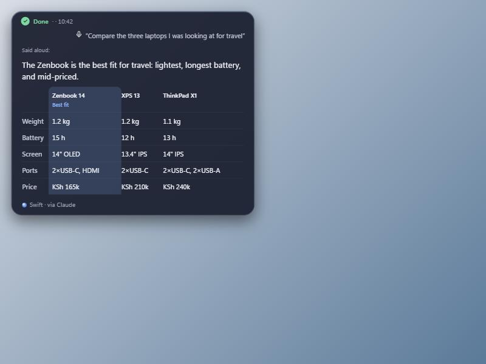
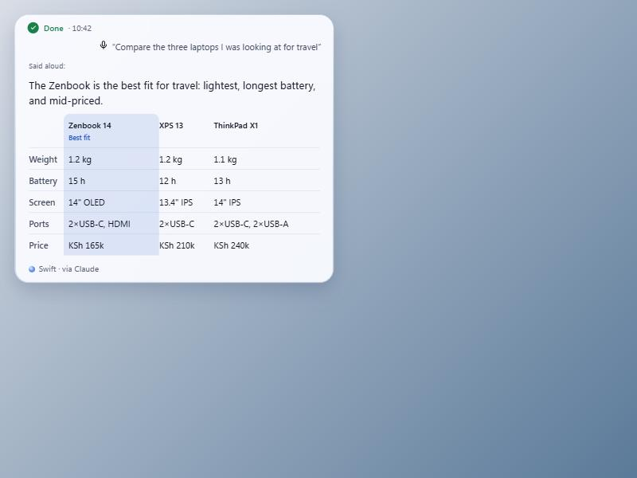
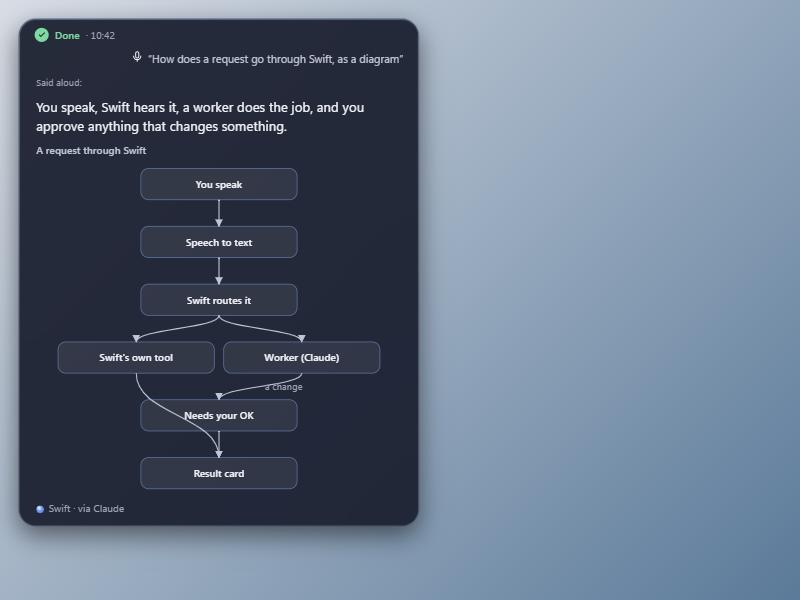
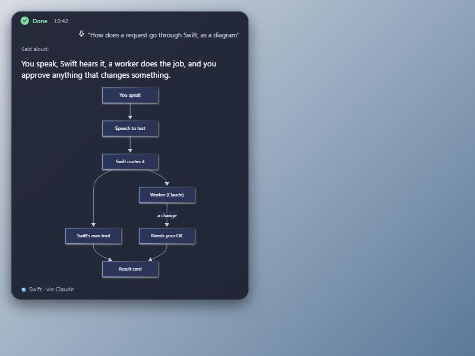
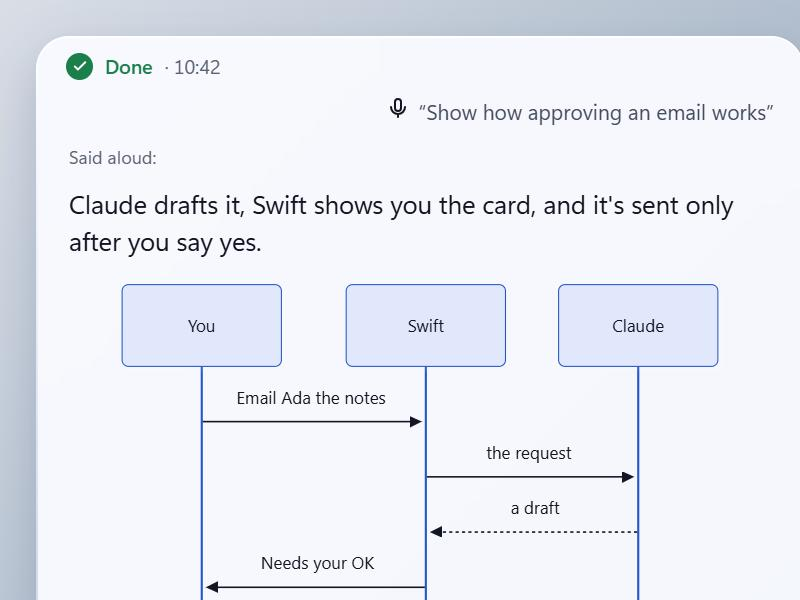
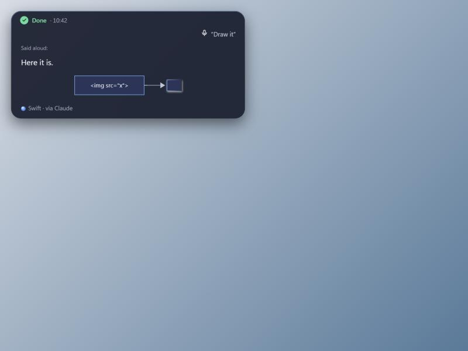

# B4: results shaped to fit them (proposal, 2026-11-13)

Status: **the owner adopted these recommendations (2026-11-13), and both pre-approval checks are done (§9).** The
checks changed one item: Windows Shell thumbnails are out (2 of 24 real files gave one), and Windows' built-in PDF
renderer plus a standard-library text excerpt replace them; the owner accepted that change on 2026-11-14.
Nothing here is built into Swift yet. A dev-only
prototype draws the shapes (`overlay/dev/b4.html`, §6).

**The owner's decision (2026-11-13):** results aren't a fixed list of layouts. For each result, Swift works out
how best to show it, visually and in words: a table, a side-by-side comparison, project cards, a real diagram, a
document preview, a chart, or plain text. The card's look follows. Swift may use free tools to make that work.

**In one paragraph:** the worker sends Swift a *typed result*, a shape plus its data, through a tool Swift
gives it, never as markup. Swift's backend checks it, may change the shape or the size it's shown at, and adds who
made it. The overlay draws it with Halo blocks that only Swift's own code draws. When anything doesn't fit, the
card shows plain text. Swift says a sentence or two aloud and the card shows the rest. The owner decided the tools question (2026-11-13): a vetted set of free
tools ships with Swift and the owner approves the list once. Anything else is installed only when needed, with a
card every time (C4). It runs on the worker's side, and its output reaches the card as data, never as code in the
overlay. §4 has the recommended set and how an install is asked for and kept.

## 1. What's there today

- The agent's final text goes through `split_answer` (`executors/claude_mapping.py:296`). The opening lines become
  the summary and the rest becomes `details`, as `text` or `list`. `table` exists in the protocol
  (`overlay/src/protocol.ts:27`), but only Swift's own tools, like the calendar, produce it. Nothing the agent
  writes reaches it, and the table hides its column headings (`styles.css:468`), so it can't hold a comparison.
- `speech.spoken()` says the summary, at most two sentences. The card shows the summary and the details.
- Halo's principle 3 (`SPEC.md` §1): **"Workers never draw. A worker returns data; Swift picks a block from its
  own catalog."** B4 keeps this. It's what makes B4 safe, not something in its way.
- The overlay has one runtime dependency (`@tauri-apps/api`). Every word goes through `textContent` (`dom.ts`).

## 2. Where the choice is made: both, with Swift having the last word

| Who | Decides | Why |
|---|---|---|
| **Worker (the agent)** | Which shape the content has, and the data for it | Only the worker knows the content: that three laptops on five measures make a comparison |
| **Swift's backend** | Whether the shape holds up, the size it's shown at (card, expanded card, reader), who it's from | The worker can't be trusted to keep a card small or to say whose words they are |
| **Swift's own tools** (calendar, email, files) | Their shape, as today | They're Swift's: their facts are drawn as Swift's own |

**How the worker says it:** an in-process tool, `show_result`, added beside `request_stronger_model`
(`claude_code.py:491` already builds an SDK MCP server). Its input schema lists the shapes. The SDK checks the
schema, then the backend checks again with pydantic (already a dependency) in a small new module,
`swift/shapes.py`, so the check doesn't grow `session.py`. The tool's description tells the worker when to use
each shape. The prompt keeps "the final answer short": that answer becomes the spoken sentence (§5).
A fenced JSON block in the final text was considered as the way in. It works for providers without tools, but it
mixes data into prose and fails quietly. Keep it only as the fallback for a second provider.

**What the backend does with it:**
1. **Check** every field: lengths, counts (a comparison has 2–4 items and up to 12 rows; a diagram up to 16 nodes),
   references (an edge to a node that doesn't exist), and no markup anywhere. Anything that fails becomes plain
   text from the worker's answer. Nothing is lost and nothing crashes.
2. **Size:** a shape that's too big for the card opens as the expanded card. That's B5's "grows when the content
   needs it", decided by Swift from the data, not by the worker.
3. **Mark who made it:** `by: "worker"` and the worker's name, set by the backend, never read from the worker.
4. **Never on an approval:** shapes appear only on Done results and in the reader. Needs your OK, Waiting for
   you and the facts box keep drawing from the action (principle 2, X-17). A shape can't hold a button, a link
   that does something, or an image from a URL.

**Reaching the overlay:** `ResultDetails` (`protocol.ts:27`) gets new kinds next to `text`, `list` and `table`:

```ts
| { kind: "compare"; items: string[]; rows: { label: string; values: string[] }[]; pick?: number; by: By }
| { kind: "diagram"; source: string; by: By }                    // Mermaid text, checked (§4)
| { kind: "chart"; type: "bar" | "line"; x: string[]; series: { name: string; values: number[] }[]; unit?: string; by: By }
| { kind: "cards"; cards: { title: string; detail?: string; meta?: string }[]; by: By }   // project cards
| { kind: "preview"; path: string; thumb: string; excerpt?: string; by: By }  // thumb: a PNG made by Swift
| { kind: "table"; columns: string[]; rows: string[][]; headed?: boolean; by?: By }       // headed: show headings
type By = { who: "swift" } | { who: "worker"; name: string };
```

**X-17 on result cards:** the byline ("Swift · via Claude") already names the worker. A worker's *judgment* inside
a shape needs its own mark too: the comparison's highlighted column, or a chart's "best". Swift's accent can't
present it as Swift's own advice. **Recommendation:** label it "Claude's pick", never "Best fit". The prototype
still says "Best fit"; that's the change to make.

## 3. The renderer: Halo Step B, and what changes in it

Step B (brief-halo.md) builds one card renderer: state line, origin line, blocks, footer. B4 needs three things
from it, and none of them adds a feature to Step B itself:

1. **Blocks are a table from kind to drawing function,** each taking typed data:
   `kind → { draw(data, size), text(data), fits(data, size) }`. `text()` gives the same content as words, for Copy,
   a screen reader and the fallback. `fits()` tells Swift whether the data fits a card or needs the expanded card.
   Step B fills the table with today's blocks; B4 then adds rows to it without touching the renderer.
2. **One block, two sizes:** the same `draw` serves the card and the expanded card/reader (`SPEC.md` §7: "one run,
   five sizes"). Today's `renderDetails(details, full)` already works this way for six rows against all rows.
3. **Heavy renderers load when needed:** `await import()`, as `look/index.ts` already loads `halo.css`. A Mermaid
   diagram costs nothing until the first diagram.

**Step B's own rule changes in one place.** `SPEC.md` §5 says "add a block only when two capabilities need it". With
the owner's decision it reads: **add a shape when Swift's own code can draw it from typed data and check that
data.** The worker can't add a shape while Swift runs; a new shape is a code change, reviewed like any other.
New blocks: **Compare, Diagram, Chart, Cards, Preview,** and Table gains headings.

**Order:** Step B first, with no protocol change, as its brief says. Then B4 adds one shape at a time, each with its
seam scenario (`tests/unit/test_seam_replay.py`) and owner checks:
1. **Compare** and headed tables. No dependency. The most common case in the owner's run (238).
2. **Diagram** through Mermaid. The one new dependency, after the owner's OK.
3. **Preview**: Windows' own PDF renderer and a text excerpt (§9). No new dependency.
4. **Chart** and **Cards**, drawn by Swift's own code.

## 4. Free tools: which shapes, licences, sizes

Sizes are npm's *unpacked* package sizes (`npm view <pkg> dist.unpackedSize`, 2026-11-13). The shipped,
minified bundle is much smaller; measure it with `vite build` before the owner approves the list. Everything below
runs inside the overlay's WebView2 or through Windows itself. **All of them run offline. Nothing sends audio or
content off the PC.**

| Shape | Tool | Licence | Size (unpacked) | Offline | New dependency? | Verdict |
|---|---|---|---|---|---|---|
| Table, compare, list, cards | Swift's own code (prototype: ~70 lines) | — | — | yes | no | **Ship** |
| Simple charts (bar, line, ≤4 series) | Swift's own SVG code (as the diagram prototype) | — | — | yes | no | **Ship** |
| Diagrams (flow, sequence, state, class, ER, timeline, gantt, quadrant, journey) | Mermaid, `@mermaid-js/tiny` 12.3 | MIT | 2.85 MB, one minified file; 0.76 MB gzipped (measured, §9) | yes | **yes** | **Ship** |
| Diagrams, full build | `mermaid` 12.3 | MIT, but it bundles elkjs (EPL-2.0/GPL) and KaTeX | 5.4 MB in 105 lazy chunks (1.6 MB gzipped) | yes | yes | Rejected: the ELK licence; tiny covers the need |
| Graph layout only | `@dagrejs/dagre` 3.1 | MIT | 1.4 MB | yes | yes | Fallback if Mermaid is refused: fixes the crossing in the prototype, but flows only |
| PDF preview (first page as PNG) | Windows' own renderer, `Windows.Data.Pdf` (Windows 10+) | Windows | 0 | yes | **no** | **Ship.** 6 of 6 PDFs rendered (§9) |
| Office preview (Word, PowerPoint, Excel) | A text excerpt from the file's XML, Python standard library (`zipfile`) | Python's | ~30 lines | yes | **no** | **Ship.** 14 of 14 real files, ≤62 ms (§9) |
| Document thumbnails | Windows Shell thumbnails (`IShellItemImageFactory`), through `comtypes` | Windows / MIT | 0 | yes | no | **Rejected after the spike:** 2 of 24 real files, failures took up to 9 s |
| Word excerpt | Word through COM (ADR-012, already used) | — | 0 | yes | no | Not needed: the standard-library excerpt doesn't open Word |
| Dense time series | uPlot 1.6 | MIT | 0.5 MB | yes | yes | Not now: own SVG covers the need |
| Charts, general | Chart.js 4.6 | MIT | 6.2 MB | yes | yes | Rejected: canvas (no text for screen readers), bigger than needed |
| Charts, grammar | Vega-Lite 6.5 + vega-embed | BSD-3 | 5.9 + 0.6 MB (+ vega) | yes | yes | Rejected: a second spec language for the worker |
| Charts, all-in-one | ECharts 6.1 | Apache-2.0 | 60 MB | yes | yes | Rejected: size |
| Graphviz | `@viz-js/viz` 3.31 (WASM) | MIT | 5.0 MB | yes | yes | Rejected: Mermaid covers it |
| Graph layout | elkjs 0.12 | EPL-2.0 or GPL-3.0+ | 8.2 MB | yes | yes | Rejected: licence |
| PDF pages | pdf.js (`pdfjs-dist` 6.5) | Apache-2.0 | 37.6 MB | yes | yes | Rejected: Windows renders PDF pages already |
| .docx to HTML | mammoth 1.13 / docx-preview 0.4 | BSD-2 / Apache-2.0 | 1.7 / 1.0 MB | yes | yes | Rejected: produces markup the overlay would have to trust |
| Math | KaTeX 0.19 | MIT | 4.0 MB | yes | yes | Not now: no request for it yet |

**Mermaid, in detail:** Claude writes Mermaid fluently, and one dependency covers almost every diagram the owner
listed. Mermaid's input is the worker's text, so it gets the same care as any worker input:
- `mermaid.parse()` first: a diagram that doesn't parse becomes text.
- `securityLevel: "strict"` and `htmlLabels: false`: labels are text, scripts and clicks are off. Mermaid sanitises
  its SVG with DOMPurify, bundled inside it.
- The SVG is parsed as SVG, never as HTML, and refused if it holds a `script` or `foreignObject` (the prototype
  does this, `overlay/dev/b4/mermaid.ts`).
- Mermaid is loaded only when the first diagram arrives, or while Swift is idle after start-up: cold, it takes
  0.8 s to load and parse once (§9).
- Halo's tokens are passed as Mermaid's `themeVariables`, so it matches dark and light.
- There's a size cap: source over a few kB, or more than about 40 nodes, opens in the reader or becomes text.

Mermaid has had XSS advisories in earlier versions. That's the reason for pinning, strict mode and the review that
comes with every version bump (`uv`/`npm` lockfiles already pin).

### The owner's decision (2026-11-13): a vetted set, and installs outside it ask

A vetted set of free tools ships with Swift, and the owner approves that list once. Anything outside the set is
installed only when needed, and Swift asks on a card every time (C4).

### The vetted set (adopted by the owner 2026-11-13, changed by the checks in §9)

| # | Tool | Covers | Licence | Size | Offline | New dependency |
|---|---|---|---|---|---|---|
| 1 | **Swift's own blocks** (overlay TypeScript) | Text, list, headed table, comparison, project cards, simple bar and line charts (≤4 series, SVG) | Swift's | ~70 lines per shape (prototype) | yes | no |
| 2 | **Mermaid**, `@mermaid-js/tiny` 12.3.0, pinned | Diagrams: flow, sequence, state, class, ER, timeline, gantt, quadrant, journey. *Not* mind maps or architecture diagrams (tiny leaves them out) | MIT | 2.85 MB minified, one file, 0.76 MB gzipped (measured) | yes: no network calls in the file, and only localhost requests when rendering (§9) | **yes**, the only one |
| 3 | **`Windows.Data.Pdf`**, Windows' own PDF renderer | A PDF's first page as a PNG on a Preview block, plus its page count | Windows | 0 | yes | no |
| 4 | **A text excerpt from Office files**, Python standard library (`zipfile` + the file's XML) | The opening words of a Word document, the first slide of a PowerPoint, an Excel file's text | Python's | ~30 lines (spike) | yes | no |
| + | Windows Shell thumbnails, opportunistically | A PowerPoint's own embedded preview picture, *when the file has one*; never asked for a PDF | Windows; `comtypes` MIT | 0 | yes | no. Optional: 2 of 6 PowerPoints had one, and a failure can take seconds, so only with a short timeout |

That's the whole set: **one new dependency.** Everything in it draws in the overlay or in Swift's backend, runs
offline, sends nothing off the PC, and loads only when a result needs it (lazy import). The list, versions and
licences go in an ADR, and the overlay's licence check covers them. A version bump is a code change, reviewed with
Mermaid's advisories in mind (strict mode, §4 above), not an install.

Kept out of the set, and why (the full table above): ECharts (60 MB), Vega-Lite (a second spec language), Chart.js
(canvas, no text for screen readers), Graphviz WASM and dagre (Mermaid covers them), elkjs (EPL/GPL licence),
pdf.js (Windows renders PDFs already) and mammoth (its HTML would have to be trusted), the full Mermaid build
(it bundles elkjs), and KaTeX (no request yet). A page *image* of a Word or PowerPoint file is left out too: it
needs Office to export it, which is slow and opens the owner's apps. If the owner wants it, it's a later step
behind "Show me", not on the card. Each can still come in later through the install path below, or by the owner adding it to the set.

### An install outside the set

**Where it runs.** An installed tool runs on the worker's side, never in the overlay page. The overlay draws Needs
your OK, so it only ever runs reviewed, shipped code. An outside tool's output reaches the card as data, or as a
PNG through the Preview block, so Swift still draws everything (principle 3). For example, a chart library the set
lacks makes a PNG, and Swift shows that PNG as a Preview. It never adds a script to the overlay. Installs go into a
folder Swift owns (`%LOCALAPPDATA%\Swift\tools\<name>\`, a `uv` venv for Python or a local `npm` prefix for Node),
never a global install and never the PATH. Removing one deletes that folder.

**How it's asked: a Needs your OK card, every time.**
- **The worker asks** through a `request_tool` tool, giving the package, the ecosystem (pip or npm) and a reason in
  a few words. Swift never installs anything from a worker's shell command: the command card refuses
  `pip install`, `npm i`, `winget` and the like, and points the worker to `request_tool`.
- **Swift looks up the facts itself** from the package index, never from the worker: the name, the exact version,
  the source (PyPI or npm), the licence, the download size, and whether it needs network access when it runs.
  If a fact can't be found, the card says so.
- **The card:** "Install *name* *version* to make the chart you asked for?" The facts box holds the source,
  licence, size, where it goes, and "works offline: yes / no / unknown". The worker's reason is shown as the
  worker's, marked as on X-17. The buttons are **Install** and **Not now**.
- **Product rules hold:** approving hands-free needs Swift's name, and a bare "yes" never installs (this isn't
  the reversible-change exception). Typing never approves. Approve ignores clicks for its first 400 ms. The card
  never times out into a yes.
- **Refused by default, without a card:** licences that aren't OSI-approved, GPL/AGPL code that would ship with
  Swift (a separate tool the worker runs is fine), packages that need a sign-in or an account (sign-in is the
  owner's), and anything that sends audio off the PC.

**How it's kept.** Each approved install writes a record to `%LOCALAPPDATA%\Swift\tools\installed.yaml`: the name,
version, source, licence, hash of what was downloaded, when, the run that asked, and that the owner approved by
voice or by click. This is a content-free record, so it fits the logging rule. The record is how Swift knows what
it has:
- **Using an installed tool again doesn't ask again.** The decision was "asking every time it is installed". An
  upgrade to a new version is a new install and asks. *For the owner to confirm (decision 3b).*
- **The owner can see and remove them:** "what tools have you installed?" reads the record, and "remove *name*"
  deletes the folder and its entry. Deleting asks on a card, as every delete does (ADR-019).
- **Promoting a tool into the vetted set** is the owner's decision and a code change, never automatic. That way the
  set grows only by review.

**Built with C4, not B4.** The install path is C4's work, after the groundwork (the `WorkerTask` grant and run
records). B4 needs only the vetted set, so B4 doesn't wait for C4.

## 5. Words and visuals: what's said and what's shown

| Said aloud | Shown |
|---|---|
| The conclusion, in one or two sentences: "The Zenbook fits travel best: lightest, longest battery, mid-priced." | The evidence: the comparison table |
| What the diagram means: "Your request goes through Swift, then a worker, and anything that changes something asks you first." | The diagram |
| For a document: what it is and the one thing that matters | The thumbnail, the excerpt, and Open |
| Never: cell values read row by row, node lists, file paths, numbers no one asked for | — |

The rules:
- **The spoken sentence stands alone.** It's the worker's final answer, kept short by the prompt and capped by
  `speech.spoken()` as today. The `show_result` tool's description tells the worker to keep data out of it.
- **A shape is never spoken.** Its title and caption are for the eye. `spoken()` already drops headings and code.
- **When the owner can't see the card** (a hands-free answer while the card is folded or behind another), add one
  of Swift's own short phrases, "It's on screen", and never read the shape instead.
- **Every shape has its text:** the block's `text()` gives the table as rows, the diagram as "A → B" lines, and the
  chart as its values. Copy, screen readers and the fallback use it.

## 6. The prototype

`overlay/dev/b4.html` with `overlay/dev/b4/shapes.ts` (dev only, nothing in `src/` imports it). It draws a Done
card in Halo with the spoken sentence and a shape, from sample typed results that go through `parseShape`, the
boundary check. Run it with the dev harness's Vite on port 1431:
`/dev/b4.html?shape=compare|diagram|bad&theme=light`. Tests are in `overlay/tests/b4-shapes.test.ts`: malformed
shapes, including markup, fall back to text, and layers stop on a cycle.

| Comparison, dark | Comparison, light | Diagram, hand-made layout |
|---|---|---|
|  |  |  |

| The same diagram, Mermaid | Sequence, Mermaid, light | Labels that try markup, Mermaid |
|---|---|---|
|  |  |  |

The Mermaid cases are `?shape=mermaid|mermaid-seq|mermaid-evil`. They need `mermaid.tiny.js` copied into
`overlay/dev/b4/vendor/`, which git ignores (the steps are in `overlay/dev/b4/mermaid.ts`).

**What it showed:**
- **The comparison works with no dependency.** Headings, row labels, a highlighted column and tabular numbers fit a
  512 px card at 3 × 5. Four items is the most a card holds; more opens the expanded card.
- **A hand-made diagram layout breaks at seven nodes.** In the screenshot, the edge from "Swift's own tool" to
  "Result card" runs through "Needs your OK". A real layout needs dummy nodes and crossing reduction, which is
  exactly what Mermaid (or dagre) already does. This is the clear need for the one new dependency.
- **The fallback holds:** `?shape=bad` (an edge to a missing node) shows the worker's words, not a broken drawing.
- **Mermaid lays the same seven nodes out with no crossing,** in Halo's colours, dark and light.
- The "Best fit" tag in Swift's accent reads like Swift's own advice. Rename it "Claude's pick" (§2).
- A sequence diagram of six messages is taller than a card: it belongs in the expanded card (`fits()`, §3).

Not checked: the real overlay (`main.ts` isn't touched, to keep clear of B1 and the screen-snapshot work), 150%
scaling, forced colours and reduced motion.

## 7. Decisions for the owner

1. **Who chooses the shape:** the worker proposes it through a `show_result` tool, and Swift checks it, sizes it
   and marks it. *Recommended.* Alternative: Swift guesses the shape from the worker's text, which is weaker and
   guesses wrong on prose.
2. **Ship or install:** **decided by the owner (2026-11-13).** A vetted set ships and is approved once. Anything
   outside it is installed when needed, with a card every time (§4).
3. **The vetted set:** **adopted by the owner (2026-11-13).** Swift's own blocks; Mermaid (`@mermaid-js/tiny`
   12.3.0, MIT), the one new dependency; Windows' PDF renderer; and a standard-library excerpt for Office files
   (§4). The checks replaced Windows thumbnails with the last two (§9). The owner accepted that change
   on 2026-11-14. *Still the owner's:* whether mind maps (which tiny leaves out) matter enough to need anything
   more.
   - **3b.** An installed tool outside the set is reused without asking again, and a new version asks again.
     *Recommended.* The other reading is to ask before every use, which means a card on every chart from that tool.
   - **3c.** Outside tools run on the worker's side and reach the card as data or a PNG, never as code in the
     overlay. *Recommended*; it follows from the product rules.
4. **The worker's judgment is labelled as the worker's** ("Claude's pick"), never in Swift's voice. *Recommended.*
5. **Order:** Halo Step B first, built as a table of typed blocks with no protocol change. Then the shapes one at a
   time: compare, diagram, preview, chart and cards. *Recommended.* B4 can't land before Step B without drawing
   everything twice.
6. **Shapes only on Done results and the reader,** never on Needs your OK or Waiting for you. *Recommended*; it
   follows from the product rules.

## 8. When it's built

- Each shape: a seam scenario that fails with it undone, owner checks numbered from "Next free check number", their
  ledger lines, and report lines.
- Routing parity unchanged: the routing doesn't move.
- Preview: decide where `Windows.Data.Pdf` is called from (§9). The spike scripts are in `spikes/b4_previews/`.
- An ADR for the shipped renderer list and the `show_result` contract.

## 9. The two checks before approval (2026-11-13, on the owner's PC)

### Mermaid's real size and behaviour

Measured from the npm tarballs, without installing them in the project (`npm pack` into a scratch folder):

| | `@mermaid-js/tiny` 12.3.0 | `mermaid` 12.3.0 (full) |
|---|---|---|
| What ships | one file, `mermaid.tiny.js` | 105 lazily loaded chunks |
| Size | 2.85 MB minified, 0.76 MB gzipped | 5.4 MB, 1.6 MB gzipped |
| Dependencies at run time | none (all bundled) | none at run time; bundles elkjs (EPL-2.0/GPL-3.0) and KaTeX |
| Diagrams | all but mind map and architecture | all |

**Timings (WebView2 / Chromium):**
- Loading and parsing the file cold takes 0.8 s, once. After that, loading it again takes 26–32 ms.
- Rendering a diagram takes 82–106 ms.
- The dev server took 5–37 s, because Vite adds a 13 MB inline source map to the file. A built Swift won't do that.

**Offline:** the file holds no `fetch` calls, and its only URLs are documentation strings. With Mermaid rendering,
the page made requests to `localhost` only.

**Markup in a worker's labels** (`?shape=mermaid-evil`):
- An `` label is drawn as the literal text ``.
- A `<script>` label is dropped, leaving an empty node.
- `click a "javascript:…"` leaves an `<a>` with no `href`.
- The rendered SVG has no `img`, `script` or `foreignObject` element and no `on*` attribute.

So strict mode holds. The one loss is that a dropped label shows as an empty box: `parseShape`'s check should
refuse labels with `<` or `>` before Mermaid sees them, and show words instead.

**Verdict:** ship `@mermaid-js/tiny` 12.3.0, pinned, imported lazily. Its README says it's meant for a CDN.
Swift bundles the same file from npm with the lockfile's integrity hash, so nothing is fetched while Swift runs.

### Document previews

- **Windows Shell thumbnails fail on this PC.** Of 24 real files (6 each of PDF, Word, PowerPoint and Excel, from
  Documents, Downloads, Desktop and OneDrive), only 2 PowerPoints gave a thumbnail.
  - PDFs have no thumbnail handler (Adobe isn't installed, and Edge doesn't register one).
  - Office's handlers only return a preview picture saved inside the file, and most files don't have one.
  - Failures took 0.1–1.8 s on the owner's files and 5–9 s on files the spike made itself.
- **`Windows.Data.Pdf` renders PDFs:** 6 of 6, the spike's own PDF and 5 of the owner's, first page to PNG, in
  0.8–2.3 s each. That's through a PowerShell helper (`Windows.Data.Pdf` through `AsTask`), and PowerShell's start-up
  is most of it.
- **The Office text excerpt works:** 14 of 14 real Word, PowerPoint and Excel files, in 1–62 ms, with the Python
  standard library alone. It reads at most 2 MB of the part, never the whole file. Four more files in the sample
  were macOS `._` metadata files with an Office name, and the check refuses them (they aren't zip files).

Only counts and timings were kept from the owner's files. No file names, text or images were saved or looked at.

**Where to call `Windows.Data.Pdf` from: decide when building Preview.**
- *A PowerShell helper from the backend* is proven here and needs no dependency, but costs about 1–2 s a page.
- *Rust in the Tauri app* uses the `windows` crate. It's already in `Cargo.lock` (0.62, through Tauri), but Swift's
  own `Cargo.toml` uses `windows-sys`, which has no WinRT, so it would be a new direct dependency on a crate that's
  already built.
- *Python's `winrt` packages* (MIT) are a new dependency.

Start with the PowerShell helper (`shortcut:` with its cost), and move to Rust if 1–2 s shows on the card.
